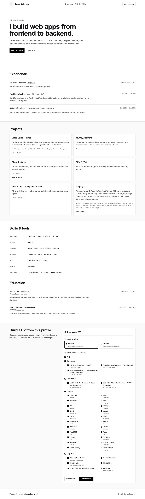
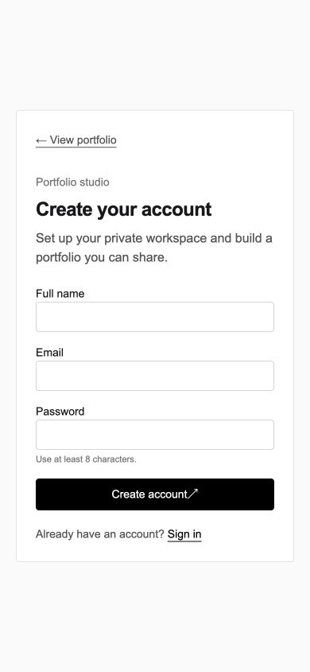

# Professional portfolio and CV builder

Hamza Oubahim · Tendances technologiques

Repository: [hamzaoub/portfolio-professionnel](https://github.com/hamzaoub/portfolio-professionnel).

A full-stack portfolio application built with React 18, Vite, TypeScript, Express, PostgreSQL 16, Redis 7, and Docker Compose. It provides a public portfolio, a private content dashboard, Redis-backed sessions and caching, and two configurable PDF CV templates.

The demo profile uses the experience and projects from my CV. I left its public email and phone fields blank. The sample account has no working sign-in password. To test the private dashboard on a new installation, register a new account. The local development account and its password are not distributed with the source code.

## Start the application

Requirements: Docker Desktop with Docker Compose. For checks outside Docker, use Node.js 24 LTS.

Copy the environment example, then set `POSTGRES_PASSWORD` and `SESSION_SECRET` in `.env` to your own local values:

```bash
cp .env.example .env
```

Start all four services with one command:

```bash
docker compose up --build
```

Compose reads the database password and session secret from the environment and requires both values. Keep `.env` out of Git. The ignore rules exclude `.env` files while keeping `.env.example` tracked.

If these default ports are already in use, set `POSTGRES_PORT`, `REDIS_PORT`, `API_PORT`, and `FRONTEND_PORT` in `.env`; set `VITE_API_URL` to the matching API host address when changing the API port. When changing the frontend port, update `CORS_ORIGIN` too.

The app starts at <http://localhost:5173>. Register at `/register`, sign in at `/login`, and manage content at `/dashboard`. The seeded portfolio is at <http://localhost:5173/p/hamza-oubahim>. The API health check is <http://localhost:3000/api/health>.

| Service    | Local address           |
| ---------- | ----------------------- |
| Frontend   | <http://localhost:5173> |
| API        | <http://localhost:3000> |
| PostgreSQL | `localhost:5432`        |
| Redis      | `localhost:6379`        |

## Features

- Account registration, login, logout, password change, and account deletion.
- Bcrypt password hashing, Redis sessions, rate limits for login and registration, request validation, parameterized SQL, Helmet headers, and configured credentialed CORS.
- Private profile editing and public/private portfolio controls, including a separate public CV download setting.
- Create, edit, delete, and reorder experience, education, skills, and projects.
- Responsive public portfolio pages with readable unique slugs.
- Redis caching for public portfolio data, invalidated after profile or content changes.
- Modern and Classic CV templates, section and entry selection, an interactive HTML preview, and a PDF preview/download.
- PDF output named `CV_Prenom_Nom.pdf` using the profile name, limited to two pages.
- Redis PDF caching keyed by user, template, selected content, and a hash of the data.
- Shared TypeScript API contracts for authentication, profile, and portfolio data in `shared/contracts.ts`.

## Screenshots





## Documentation

- [API reference](docs/api.md)
- [Architecture and technical choices](docs/architecture.md)
- [Entity-relationship diagram](docs/er-diagram.md)
- [Requirements traceability and remaining acceptance evidence](docs/requirements-traceability.md)
- [Test report](docs/test-report.md)
- [12-minute demonstration script](docs/demo-script.md)
- [Generated sample CV](output/pdf/CV_Hamza_Oubahim.pdf)

## Development checks

Run these from the relevant package directory. The backend integration test uses the local API, PostgreSQL, and Redis, so start Compose first.

```bash
cd backend
npm ci
npm run build
npm run lint
npm run format:check
npm test
```

```bash
cd frontend
npm ci
npm run build
npm run lint
npm run format:check
npm test
```

For a different API port, set `PORTFOLIO_API_URL` to that API address when running the backend tests. The integration test creates a randomized temporary account and removes it when it finishes. Frontend tests use Vitest, jsdom, and React Testing Library.

## Libraries

The interface uses React, React Router, and Tailwind CSS with Vite. The API uses Express, pg, redis, express-session, connect-redis, bcryptjs, Zod, CORS, Helmet, and PDFKit. Checks use TypeScript, ESLint, Prettier, Vitest, jsdom, and React Testing Library. The package manifests and lockfiles in `backend/` and `frontend/` record the dependencies and their versions. The PDFKit choice is explained in the architecture document.

## Project layout

```text
.
├── docker-compose.yml
├── backend/
│   ├── db/init.sql
│   ├── src/
│   │   ├── db.ts
│   │   ├── http.ts
│   │   ├── index.ts
│   │   ├── redis.ts
│   │   ├── session.ts
│   │   └── routes/
│   └── tests/
├── shared/
│   └── contracts.ts
├── docs/
└── frontend/src/
```

## How the main parts work

- `frontend/src/App.tsx` requests a public profile by its slug and renders the portfolio sections.
- `shared/contracts.ts` defines the API data types used by both the frontend and backend.
- `frontend/src/CVBuilder.tsx` keeps the selected sections and entries, then sends them to the CV routes.
- `backend/src/routes/cv.ts` reads the selected profile data and uses PDFKit to create the download. Redis caches generated PDFs.
- `backend/src/routes/public.ts` caches public portfolio data in Redis. Profile and content updates clear the matching cache entry.

The browser shows an HTML preview. The downloaded PDF uses the same profile data and selected content.

The required application features are implemented. The [requirements matrix](docs/requirements-traceability.md) lists the remaining delivery and manual-review work. Optional extensions such as image uploads, certifications, analytics, a contact form, dark mode, bilingual UI, deployment, and DOCX/JSON Resume export are not part of this version. See the architecture document for cache and session behavior.

## Production deployment

`docker-compose.production.yml` uses a compiled Node.js API and a static Nginx frontend. PostgreSQL and Redis have persistent volumes and no published host ports. Nginx forwards `/api/` requests to the API, so the browser uses the same public origin for pages and sessions. Production session cookies require HTTPS.

On Coolify, the application is configured under **hamza → Hamza CV → production**. Coolify generates the database password and session secret; these values are not stored in Git.

The Linux amd64 images are available in the [production release](https://github.com/hamzaoub/portfolio-professionnel/releases/tag/portfolio-deploy-20261106). Load the archive with `docker load -i portfolio-images-linux-amd64.tar.gz` before deploying it. In Coolify, select the production Compose file and set the custom build command to `docker compose config --quiet --no-env-resolution` and the custom start command to `docker compose up -d --no-build`. The build command validates the Compose configuration using Coolify’s build-time variables without loading the per-service `.env` files that Coolify creates for startup. The start command uses those runtime variables and the preloaded images, so it does not compile on the deployment server. The Dockerfiles also retain the development targets used by the default Compose file.
