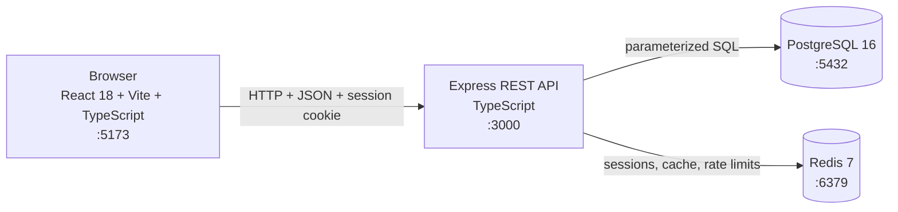

# Architecture and technical choices

## Services

Docker Compose starts the four required services. PostgreSQL is the source of truth for accounts and portfolio content. Redis stores Express sessions, login/registration rate-limit counters, public portfolio responses, and generated PDFs.

The frontend and API import their shared JSON response contracts from `shared/contracts.ts`. The imports are type-only, so the backend output does not need a runtime dependency on the shared directory.

## Request paths

For a simple overview, see [how the backend works](backend-uml.md).

- Public pages request `GET /api/public/:slug`. The API checks Redis first, then queries PostgreSQL and caches the public result for five minutes. Profile updates, slug changes, content mutations, and account deletion invalidate the public portfolio cache.
- Private API routes use the `portfolio.sid` cookie and `requireAuth`. Every profile and content query is scoped to the session's user ID.
- Registration and login hash/check passwords with bcrypt. Successful authentication regenerates and saves the session in Redis. Login and registration attempts are rate-limited in Redis.
- CV requests load data from PostgreSQL. Public visitors need both `is_public` and `allow_cv_download`; an authenticated owner can generate their own CV while the portfolio remains private. The PDF cache key includes user ID, template, selected sections/items, and a SHA-256 hash of the source data.

## Session and browser protections

`express-session` uses `connect-redis` as its session store. Cookies are HTTP-only, `SameSite=Lax`, and valid for seven days; `Secure` is enabled in production. The production API refuses a missing, short, or example `SESSION_SECRET`. CORS allows the configured frontend origin with credentials. Helmet supplies common security headers. JSON request bodies are limited to 1 MB and validated with Zod before database writes.

## PDF generation choice

PDFKit is used for server-side PDF output. The CVs are text-first, the Classic and Modern layouts can share one typed data pipeline, and PDF generation does not need a headless browser. The frontend provides a live HTML preview for selection and template changes; the PDF endpoints provide an inline PDF preview and an attachment download.

Generated PDFs are cached in Redis for 30 minutes. The cache key includes the user, template, content selection, and a hash of the current portfolio data, so changing profile or content produces a different cache key.

## Data model

Each user owns one profile and zero or more experiences, education records, skills, and projects. Child records use `ON DELETE CASCADE`; each editable list has a `sort_order` value. The full schema and foreign-key relationships are shown in the [ER diagram](er-diagram.md).

## Environment variables

| Variable            | Purpose                                                         |
| ------------------- | --------------------------------------------------------------- |
| `POSTGRES_USER`     | PostgreSQL application user for Compose.                        |
| `POSTGRES_PASSWORD` | Local PostgreSQL password; change the example value.            |
| `POSTGRES_DB`       | Database name for Compose.                                      |
| `SESSION_SECRET`    | Secret used to sign session cookies; use a unique random value. |
| `CORS_ORIGIN`       | Allowed frontend origin, defaulting to `http://localhost:5173`. |
| `DATABASE_URL`      | Internal PostgreSQL URL supplied by Compose to the backend.     |
| `REDIS_URL`         | Internal Redis URL supplied by Compose to the backend.          |
| `PORT`              | Backend HTTP port, defaulting to `3000`.                        |
| `VITE_API_URL`      | Frontend API origin, set by Compose to `http://localhost:3000`. |
| `POSTGRES_PORT`     | Optional host port for PostgreSQL; defaults to `5432`.          |
| `REDIS_PORT`        | Optional host port for Redis; defaults to `6379`.               |
| `API_PORT`          | Optional host port for the API; defaults to `3000`.             |
| `FRONTEND_PORT`     | Optional host port for Vite; defaults to `5173`.                |

Copy `.env.example` to `.env` and replace the password and session-secret placeholders before starting Compose. Both values are required; Compose has no password or secret fallback. Do not commit `.env`; `.env.example` contains placeholders and optional port defaults only.
