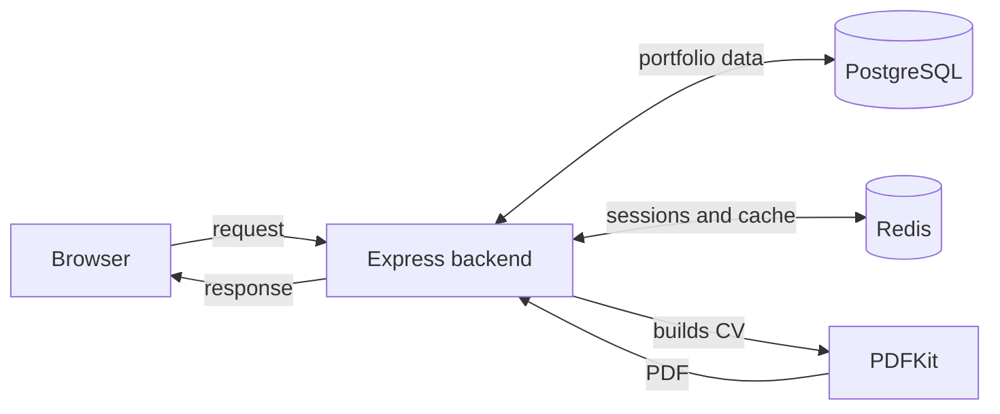

# How the backend works

- PostgreSQL stores accounts and portfolio content.
- Redis keeps login sessions and cached pages or CVs.
- Public pages use the cache first. The API reads PostgreSQL when the page is not cached.
- Editing portfolio content requires a login. The API saves changes to PostgreSQL and clears related cached data.
- PDFKit creates CV files from saved portfolio data.
