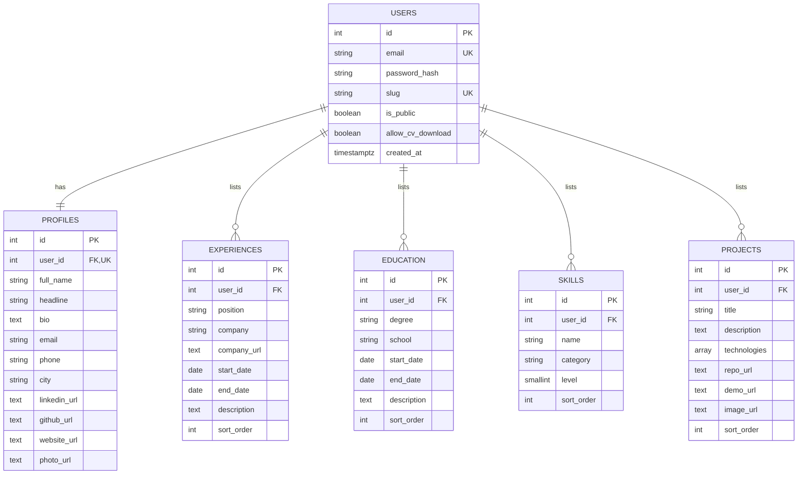

# Entity-relationship diagram

The `users` table stores sign-in and visibility fields. `profiles` stores public identity and contact content. The four list tables are user-owned records and are deleted automatically when their account is deleted. Skill `level`, when supplied, is limited to 1–5.
